# ⏱️ Timed Challenge 1 - Reverse the Sentence

<div align="center">




</div>

A timed one, so I kept it short. [timedsentence.py](timedsentence.py) prints the words of a sentence in the opposite order.

## ▶️ How to run

```bash
python timedsentence.py
```

There is no prompt, I just type the line and press Enter:

```
You have entered a wrong domain
domain wrong a entered have You
```

## 🎯 The challenge

`reverse_words(line)` is three lines:

1. `line.split()` cuts the sentence into words on any whitespace.
2. `words.reverse()` flips the list in place.
3. `" ".join(words)` puts it back together with one space between words.

`main()` catches `EOFError`, so running it with empty input prints an empty line instead of a traceback.

## 🧠 What I learned

- `split()` without an argument ignores extra spaces, so `"  hello   big  world "` gives `world big hello`
- `list.reverse()` returns `None`, so writing `words = words.reverse()` would have lost my list
- Catching `EOFError` matters when input is piped in instead of typed

---

## 👤 Author

**Kevin Cusnir 'Lirioth'**  
Repository: [Fullstack2026](https://github.com/LiriothTeltanion/Fullstack2026)  
Week 1 Day 3 - Dictionaries - Timed Challenge 1
