# 🗂️ Day 3 — Dictionaries

Dictionary day. I practised key-value pairs, `.get()` for keys that might be missing, nested dictionaries and building a dictionary out of two lists. Each exercise is one script, Python 3.10+ and nothing to install.

## Contents

| Folder | What it is |
|--------|------------|
| [`Exercises/ExercisesXP/`](Exercises/ExercisesXP/) | `zip()`, Cinemax ticket prices, the nested Zara brand dictionary and Disney character maps |
| [`Exercises/ExercisesXPPlus/`](Exercises/ExercisesXPPlus/) | A student grade summary and a small sales report |
| [`Exercises/ExercisesXPGold/`](Exercises/ExercisesXPGold/) | Birthday lookups and a fruit shop total |
| [`Exercises/ExercisesXPNinja/`](Exercises/ExercisesXPNinja/) | A list of car makers: counting, sorting and removing duplicates |
| [`Exercises/TimedChallenge1/`](Exercises/TimedChallenge1/) | Print a sentence with its words in reverse order |
| [`Exercises/TimedChallenge2/`](Exercises/TimedChallenge2/) | Is this a perfect number? |
| [`DailyChallenge/Dictionaries/`](DailyChallenge/Dictionaries/) | Where each letter appears in a word, and what I can buy with my wallet |
| [`DailyChallenge/CaesarCypher/`](DailyChallenge/CaesarCypher/) | A Caesar cipher that encrypts, decrypts and tries every shift |
| [`Exercises/RemoteExerciseListComprehension/`](Exercises/RemoteExerciseListComprehension/) | six tasks solved with list, dict and set comprehensions |

---

## 👤 Author

**Kevin Cusnir 'Lirioth'**  
Repository: [Fullstack2026](https://github.com/LiriothTeltanion/Fullstack2026)  
Week 1 Day 3 - Dictionaries
