# 💪 Daily Challenge - Coffee Shop Menu Manager

<div align="center">




</div>

A console program for a small coffee shop: show the menu, add a drink, change a price, delete a drink and exit. The menu is a dictionary (drink name → price), and every action is its own function.

## ▶️ How to run

```bash
python coffeeshopmenumanager.py
```

```
What would you like to do?
1. Show menu
...
> 2
Enter new drink name: mocha
Enter price: 14
"mocha" added!
```

## 🎯 The challenge

| Function | What it does |
|---|---|
| `show_menu(menu_dict)` | Prints every drink as `drink - price₪`, or `The menu is empty.` |
| `add_item(menu_dict)` | Asks for a name and a price, then adds the drink. An existing drink prints `Item already exists!` and keeps its price. |
| `update_price(menu_dict)` | Changes the price of an existing drink, or prints `Item not found.` |
| `delete_item(menu_dict)` | Removes an existing drink, or prints `Item not found.` |
| `show_options()` | Prints the list of actions. |
| `run_coffee_shop()` | The main loop: reads a choice and calls the matching function until the user picks 5. |

Extras: a negative or non-numeric price prints `Invalid price.`, `search_item()` is option 6, and `apply_discount(menu, percent)` lowers every price.

The loop calls the actions through a dictionary (`"1": show_menu`, …) instead of a long `if / elif` chain.

## 🧪 Tests

From the repository root:

```bash
python -m unittest discover -s tests/python -p "test_week1_day4*" -v
```

19 tests script the keyboard answers and check the printed lines and the menu after each action.

## 🧠 What I learned

- Splitting a program into small functions makes each part easy to test on its own
- A dictionary is mutable, so the functions change the menu they receive and return nothing
- The order of `input()` calls matters: one missing question shifts every answer after it
- `if __name__ == "__main__":` keeps the program from starting when a test imports it

---

## 👤 Author

**Kevin Cusnir 'Lirioth'**  
Repository: [Fullstack2026](https://github.com/LiriothTeltanion/Fullstack2026)  
Week 1 Day 4 - Functions - Daily Challenge
