# 💪 Daily Challenges

The two Day 4 daily challenges.

## Contents

- [`SolveTheMatrix/`](SolveTheMatrix/) — reading a character grid by columns to find a hidden message
- [`CoffeeShopMenuManager/`](CoffeeShopMenuManager/) — a console menu manager where each action is its own function, with 19 tests

---

## 👤 Author

**Kevin Cusnir 'Lirioth'**  
Repository: [Fullstack2026](https://github.com/LiriothTeltanion/Fullstack2026)  
Week 1 Day 4 - Functions - Daily Challenges
