# 🥇 Exercises XP Gold

<div align="center">




</div>

Three Gold exercises in [xpgoldfunctions.py](xpgoldfunctions.py): can someone retire based on gender and date of birth, what is X + XX + XXX + XXXX, and how many throws does it take to roll doubles with two dice.

## ▶️ How to run

```bash
python xpgoldfunctions.py
```

It asks for a gender and a birthdate, then a digit, and then runs the dice part by itself:

```
=== Exercise 1 ===
Gender (m/f): m
DOB (yyyy/mm/dd): 1955/05/03
You can retire.
=== Exercise 2 ===
Enter a digit X: 3
Result: 3702
=== Exercise 3 ===
Total throws: 658
Average throws to reach doubles: 6.58
```

The dice results are random. There is a commented `random.seed(0)` line in the script for when I want the same numbers every run.

## 🎯 The challenge

| Function | What it does |
|---|---|
| `get_age(year, month, day)` | Year difference, minus one if this year's birthday is still ahead. |
| `can_retire(gender, date_of_birth)` | Splits `yyyy/mm/dd` with `map(int, ...)` and checks the age against 67 for `m` and 62 for `f`. Anything else raises `ValueError`. |
| `series_sum(x)` | `sum(int(str(x) * k) for k in range(1, 5))`, so 3 becomes 3 + 33 + 333 + 3333 = 3702. |
| `throw_dice()` | `random.randint(1, 6)`. |
| `throw_until_doubles()` | Throws two dice in a `while True` loop and returns the count when they match. `main()` does this 100 times and prints the total and the average. |

The exercise had a fixed "today" date written in. I used `datetime.date.today()` and added a `TODAY_OVERRIDE` constant, so a fixed date can still be plugged in for testing.

## 🧠 What I learned

- Turning a digit into text and repeating it (`str(3) * 4` is `"3333"`) is easier than doing the math with powers of 10
- `(today.month, today.day) < (month, day)` answers "has the birthday passed?" in one comparison
- `while True` with a `return` inside fits a loop where I can't know the number of rounds
- The input parts have no checks, so a typo in the date or a letter for X still crashes the script

---

## 👤 Author

**Kevin Cusnir 'Lirioth'**  
Repository: [Fullstack2026](https://github.com/LiriothTeltanion/Fullstack2026)  
Week 1 Day 4 - Functions - Exercises XP Gold
