# 🥷 Exercises XP Ninja

<div align="center">




</div>

The harder Day 4 set, all in [xpninjafunctionssingle.py](xpninjafunctionssingle.py): building full names, translating to and from Morse code, printing text inside a star box, and writing insertion sort by hand.

## ▶️ How to run

```bash
python xpninjafunctionssingle.py
```

It runs a short demo for each of the four exercises:

```
=== Exercise 1: Names ===
John Hooker Lee
Bruce Lee
Bruce O'Connor-Smith Lee

=== Exercise 2: Morse ===
'SOS HELP 123' -> '... --- ... / .... . .-.. .--. / .---- ..--- ...--'
...
=== Exercise 4: Insertion Sort ===
Before: [54, 26, 93, 17, 77, 31, 44, 55, 20]
After:  [17, 20, 26, 31, 44, 54, 55, 77, 93]
```

## 🎯 The challenge

| Function | What it does |
|---|---|
| `get_full_name()` | Takes keyword-only arguments and an optional middle name: `get_full_name(first_name="john", middle_name="hooker", last_name="lee")` gives `'John Hooker Lee'`. |
| `smart_cap()` | Fixes the capitalization, including hyphens and apostrophes: `"o'connor-smith"` becomes `"O'Connor-Smith"`. |
| `text_to_morse()` / `morse_to_text()` | Use two dictionaries (one is the reverse of the other). Letters are separated by spaces and words by ` / `. Unsupported characters raise a `ValueError`. |
| `box_printer(*strings)` | Accepts any number of strings, pads them to the longest one, prints the star frame and also returns it. |
| `insertion_sort()` | Sorts the list in place, like sorting cards in your hand: bigger items shift right and the current one drops into its spot. |

```
******************
* Hello          *
* World          *
* in             *
* reallylongword *
* a              *
* frame          *
******************
```

## 🧠 What I learned

- `*args` lets a function take any number of arguments
- A reversed dictionary (`{v: k for k, v in d.items()}`) gives a two-way lookup
- Keyword-only parameters (after `*`) make calls easier to read
- Insertion sort is O(n²) in the worst case but O(n) when the list is almost sorted

---

## 👤 Author

**Kevin Cusnir 'Lirioth'**  
Repository: [Fullstack2026](https://github.com/LiriothTeltanion/Fullstack2026)  
Week 1 Day 4 - Functions - Exercises XP Ninja
