# 📚 Exercises

Three levels of function exercises from Day 4, and one timed challenge.

## Contents

- [`ExercisesXP/`](ExercisesXP/): seven short ones, from `describe_city()` with a default country to a temperature advice program
- [`ExercisesXPGold/`](ExercisesXPGold/): can this person retire, the X + XX + XXX + XXXX sum, and rolling two dice until doubles
- [`ExercisesXPNinja/`](ExercisesXPNinja/): name formatting, a Morse translator, a framed box of words and an insertion sort
- [`TimedChallenge1/`](TimedChallenge1/): count one character in a string, case-sensitive

---

## 👤 Author

**Kevin Cusnir 'Lirioth'**  
Repository: [Fullstack2026](https://github.com/LiriothTeltanion/Fullstack2026)  
Week 1 Day 4 - Functions - Exercises
