# ⏱️ Timed Challenge 1 - Count Character Occurrence

<div align="center">




</div>

[countoccurence.py](countoccurence.py) counts how many times one character appears in a string. Upper and lower case count as different characters.

## ▶️ How to run

```bash
python countoccurence.py
```

No prompts: the first line I type is the string and the second is the character:

```
Programming is cool!
o
3
```

`Hello World` with `l` gives `3`, and `This is a great example` with `y` gives `0`.

## 🎯 The challenge

The whole solution:

```python
def count_char(s: str, ch: str) -> int:
    target = ch[0] if ch else ''
    return sum(1 for c in s if c == target) if target else 0
```

- `'A'` and `'a'` don't match, the comparison is exact
- If I type more than one character, only the first one counts
- An empty second line returns `0`, and `main()` prints `0` if the input ends early (`EOFError`)

Looking at it again, `s.count(ch[0])` would do the same job in one call.

## 🧠 What I learned

- `sum(1 for ...)` counts matches without a counter variable
- Reading `ch[0]` on an empty string raises `IndexError`, so I check `ch` first
- Handling `EOFError` in both `input()` calls keeps piped input from crashing it
- In a timed challenge I went for the version I could trust first, the shorter built-in came after

---

## 👤 Author

**Kevin Cusnir 'Lirioth'**  
Repository: [Fullstack2026](https://github.com/LiriothTeltanion/Fullstack2026)  
Week 1 Day 4 - Functions - Timed Challenge 1
