# 🧩 Day 4 — Functions

Functions: parameters and defaults, return values, scope, `*args`, and splitting a problem into small reusable pieces. Every exercise is a single script using only the standard library.

## Contents

| Folder | What it is |
|--------|------------|
| [`Exercises/ExercisesXP/`](Exercises/ExercisesXP/) | Seven warm-ups: defaults, keyword arguments, `random`, list mutation, a weather report |
| [`Exercises/ExercisesXPGold/`](Exercises/ExercisesXPGold/) | Retirement check with dates, X + XX + XXX + XXXX, a dice simulation |
| [`Exercises/ExercisesXPNinja/`](Exercises/ExercisesXPNinja/) | Name capitalization, Morse code, a star box with `*args`, insertion sort |
| [`Exercises/TimedChallenge1/`](Exercises/TimedChallenge1/) | Counting how many times a character appears in a string |
| [`DailyChallenge/SolveTheMatrix/`](DailyChallenge/SolveTheMatrix/) | Reading a character grid by columns to find a hidden message |
| [`DailyChallenge/CoffeeShopMenuManager/`](DailyChallenge/CoffeeShopMenuManager/) | A console menu manager where each action is its own function |

---

## 👤 Author

**Kevin Cusnir 'Lirioth'**  
Repository: [Fullstack2026](https://github.com/LiriothTeltanion/Fullstack2026)  
Week 1 Day 4 - Functions
