# 🔬 Advanced Algorithm - Two Sum Problem

<div align="center">




</div>

My solution to the two-sum daily challenge: generate 20,000 random numbers and find every pair that adds up to a target (3728 by default). I wrote two versions, a hash-based one and a two-pointer one, so I could compare them.

## Files

```
AdvancedAlgorithm/
├── main.py            # Command-line runner
└── src/
    ├── pairs.py       # find_value_pairs_hash() and find_value_pairs_two_pointer()
    └── demodata.py    # make_dataset() builds the random list
```

## How to run

Run it from this folder. The code uses `int | None` type hints, so it needs Python 3.10 or newer.

```bash
python main.py                      # 20,000 numbers, target 3728, hash algorithm
python main.py --seed 42            # same numbers every run
python main.py --algo two-pointer   # use the sorted two-pointer version
python main.py --n 10000 --target 5000 --sample 5
```

Other options: `--low` and `--high` set the number range (0 to 10,000 by default). It prints the number of unique pairs, the time in milliseconds and a few sample pairs.

## The problem

Return the unique value pairs `(a, b)` with `a + b = target` and `a ≤ b`, and also count how many index pairs exist when values repeat.

```python
numbers = [1, 2, 3, 4, 5, 6]
target = 7
# unique pairs: [(1, 6), (2, 5), (3, 4)]

# with [1, 2, 2, 5, 5, 5], (2, 5) appears as 2 × 3 = 6 index pairs
```

## Two approaches

**Hash-based, O(n) time and space.** Count every number with `Counter`, then for each unique `a` check whether `target - a` is there. Multiply the counts to get index pairs. When `a + a = target` you need at least two copies, and the count is `n × (n - 1) / 2`. This is the only version that also returns the index-pair total.

```python
from collections import Counter

counts = Counter(nums)
for a in sorted(counts):
    b = target - a
    if b in counts:
        ...  # pairing logic
```

**Two-pointer, O(n log n).** Sort a copy, put one pointer at each end and move them inward depending on whether the sum is too small or too big. It returns unique value pairs only.

```python
sorted_nums = sorted(nums)
left, right = 0, len(sorted_nums) - 1
while left < right:
    current_sum = sorted_nums[left] + sorted_nums[right]
    if current_sum == target:
        ...  # found a pair
    elif current_sum < target:
        left += 1
    else:
        right -= 1
```

## What I learned

- Replacing nested loops (O(n²)) with a hash table lookup
- The two-pointer technique on a sorted list
- Counting combinations when values repeat
- Timing code with `time.perf_counter()` and adding options with `argparse`

Next I'd like to try three-sum and a chart of how the time grows with the list size.

## 👤 Author

**Kevin Cusnir 'Lirioth'**  
Repository: [Fullstack2026](https://github.com/LiriothTeltanion/Fullstack2026)  
Week 1 Day 5 - Daily Challenge
