# 📦 Source - Advanced Algorithm

The modules that [main.py](../main.py) imports for the two-sum challenge.

## Contents

- [`pairs.py`](pairs.py) — `find_value_pairs_hash()` and `find_value_pairs_two_pointer()`
- [`demodata.py`](demodata.py) — `make_dataset()` builds the random list and returns it with the target 3728

---

## 👤 Author

**Kevin Cusnir 'Lirioth'**  
Repository: [Fullstack2026](https://github.com/LiriothTeltanion/Fullstack2026)  
Week 1 Day 5 - Mini-projects - Advanced Algorithm
