# 💪 Daily Challenge - String Sorting and Longest Word

<div align="center">




</div>

Two string problems in [challenges.py](challenges.py). The first sorts words typed with commas between them. The second finds the longest word in a sentence, where only letters count toward the length.

## ▶️ How to run

```bash
python challenges.py
```

It asks for the words and prints them sorted. Then five `assert` checks for `longest_word()` run on their own. No extra output means they all passed.

```
Enter comma-separated words: banana,apple,cherry,date
apple,banana,cherry,date
```

## 🎯 The challenge

| Function | What it does |
|---|---|
| `sort_comma_separated(words)` | Splits on commas, strips spaces and skips empty pieces, so `"  apple  ,  banana  "` is fine. If nothing is left, `_cli()` prints `No valid words were provided`. |
| `longest_word(sentence)` | Returns the winning word exactly as written, punctuation and all (`Margaret's`, `forever.`), but measures it by letters only. `Wow!!!` counts as 3. The first word wins a tie, and a sentence with no letters returns `""`. |

The loop strips everything that isn't a letter just for measuring:

```python
for w in words:
    cleaned = re.sub(r"[^A-Za-z]", "", w)
    if not cleaned:
        continue
    if len(cleaned) > longest_length:
        best = w
        longest_length = len(cleaned)
```

| Sentence | Result |
|----------|--------|
| `Margaret's toy is a pretty doll.` | `Margaret's` |
| `A thing of beauty is a joy forever.` | `forever.` |
| `Forgetfulness is by all means powerless!` | `Forgetfulness` |
| `!!! 123 ...` | `""` |

The sort is plain `sorted()`, so capital letters come before lowercase ones (`Zebra` before `apple`).

## 🧠 What I learned

- `[part.strip() for part in words.split(",") if part.strip()]` cleans the input in one line
- Keeping two versions of the word, the original `w` and the `cleaned` one, let me measure one and return the other
- Using `>` and not `>=` is what makes the first word win a tie
- A few `assert` lines at the bottom were a quick way to check my edge cases every run

---

## 👤 Author

**Kevin Cusnir 'Lirioth'**  
Repository: [Fullstack2026](https://github.com/LiriothTeltanion/Fullstack2026)  
Week 1 Day 5 - Mini-projects - Daily Challenge
