# 💪 Daily Challenges

Day 5 had two daily challenges, one about strings and one about speed.

## Contents

- [`Challenges/`](Challenges/): sort words typed with commas, and pick the longest word in a sentence by counting letters only
- [`AdvancedAlgorithm/`](AdvancedAlgorithm/): every pair of numbers that adds up to 3728, found two different ways and timed

---

## 👤 Author

**Kevin Cusnir 'Lirioth'**  
Repository: [Fullstack2026](https://github.com/LiriothTeltanion/Fullstack2026)  
Week 1 Day 5 - Mini-projects - Daily Challenges
