# 💪 Challenges Set 1 - 20 Python Exercises

<div align="center">




</div>

Twenty small functions I wrote to practice Week 1 Python: lists, strings, loops, conditionals and a bit of math. They are all in `challengessolutions.py`, with type hints and a short docstring each.

## How to run

```bash
python challengessolutions.py
```

No extra packages needed. It runs a quick demo that calls every function once:

```
=== Quick Demo ===
1) insert_at: [1, 99, 2, 3]
2) count_spaces: 6
3) count_case: {'upper': 2, 'lower': 4}
...
20) mask_password: **********
```

## The exercises

| # | Function | What it does |
|---|----------|--------------|
| 1 | `insert_at` | Insert an item at an index |
| 2 | `count_spaces` | Count the spaces in a string |
| 3 | `count_case` | Count upper and lower case letters |
| 4 | `my_sum` | Sum a list without `sum()` |
| 5 | `find_max` | Find the largest number |
| 6 | `factorial` | Factorial of n |
| 7 | `list_count` | Count how many times an element appears |
| 8 | `norm` | Square root of the sum of squares |
| 9 | `is_mono` | Check if a list is monotonic |
| 10 | `longest_word` | Longest word in a list |
| 11 | `split_ints_and_strs` | Separate integers from strings (booleans and floats are skipped) |
| 12 | `is_palindrome` | Palindrome check (case-insensitive) |
| 13 | `sum_over_k` | Count the words longer than k |
| 14 | `dict_avg` | Average of a dictionary's values |
| 15 | `common_div` | Common divisors of two numbers, using a GCD helper |
| 16 | `is_prime` | Prime check |
| 17 | `weird_print` | Keep elements where both the index and the value are even |
| 18 | `type_count` | Count the types of keyword arguments |
| 19 | `split_like` | My own version of `str.split()` |
| 20 | `mask_password` | Replace every character with `*` |

## What I learned

- Writing small functions with clear inputs and outputs
- Rebuilding built-ins like `sum`, `max` and `split` by hand to see how they work
- Edge cases such as `bool` being a subclass of `int` in Python

## 👤 Author

**Kevin Cusnir 'Lirioth'**  
Repository: [Fullstack2026](https://github.com/LiriothTeltanion/Fullstack2026)  
Week 1 Day 5 - Mini Project
