# 🎨 Challenges Set 2 - Pattern Drawing & Algorithm Analysis

<div align="center">




</div>

Two exercises: drawing star patterns with loops, and reading a short sorting snippet line by line to understand what it does.

## Files

```
Challenges2/
├── main.py              # Runs both exercises
└── src/
    ├── patterns.py      # pattern_a(), pattern_b(), pattern_c()
    └── ex2analysis.py   # Annotated code + step-by-step trace
```

## How to run

From this folder:

```bash
python main.py
```

## Exercise 1: Patterns

Each function builds the lines with string multiplication (`" " * n`, `"*" * n`), prints the pattern and also returns it as a string.

```
Pattern A      Pattern B      Pattern C
  *                *          *
 ***              **          **
*****            ***          ***
                ****          ****
               *****          *****
                              *****
                               ****
                                ***
                                 **
                                  *
```

The pyramid uses `h - i` spaces and `2 * i - 1` stars per row:

```python
for i in range(1, h + 1):
    spaces = " " * (h - i)
    stars = "*" * (2 * i - 1)
    lines.append(spaces + stars)
```

## Exercise 2: Code analysis

The exercise gave this code and asked what it does:

```python
my_list = [2, 24, 12, 354, 233]
for i in range(len(my_list) - 1):
    minimum = i
    for j in range(i + 1, len(my_list)):
        if (my_list[j] < my_list[minimum]):
            minimum = j
            if (minimum != i):
                my_list[i], my_list[minimum] = my_list[minimum], my_list[i]
print(my_list)
```

It's a variant of selection sort that swaps as soon as it finds a smaller value, instead of once at the end of the inner loop. `ex2analysis.py` holds my commented version of the code and a function that records `i`, `j`, `minimum` and the list after every check or swap. The trace shows only two swaps are needed, and the final output is `[2, 12, 24, 233, 354]`.

## What I learned

- Controlling rows and spacing with loops and simple formulas
- Returning values instead of only printing, so functions can be reused
- Tracing code by hand (and in code) to understand an algorithm before trusting it

## 👤 Author

**Kevin Cusnir 'Lirioth'**  
Repository: [Fullstack2026](https://github.com/LiriothTeltanion/Fullstack2026)  
Week 1 Day 5 - Mini Project
