# Src

<div align="center">




</div>

Source modules for this project.

## Contents

- [`ex2analysis.py`](ex2analysis.py)
- [`patterns.py`](patterns.py)

## Run

From the repository root:

```bash
python Week1Python/Day5MiniProject/Exercises/Challenges2/src/ex2analysis.py
python Week1Python/Day5MiniProject/Exercises/Challenges2/src/patterns.py
```
