# 🎮 Mini-Project #2 — Hangman (Python)

<div align="center">




</div>

A Hangman game for the terminal that I built for the Week 1 Day 5 mini project. It picks a random word or phrase, shows ASCII gallows, and gives you 6 wrong guesses before you lose. I used it to practice conditionals, loops, functions, a small class and splitting code into modules.

## Files

```
Hangman/
├── main.py          # Game loop, input and "play again"
└── src/
    ├── game.py      # HangmanGame class (game state)
    ├── words.py     # Word list + random_word()
    └── art.py       # 7 gallows frames, MAX_WRONG = 6
```

No external packages, just Python 3.

## How to run

From this folder:

```bash
python main.py
```

## How to play

- Type one letter and press Enter. Upper or lower case both work.
- Letters you haven't found show as `*`. Spaces stay visible, so `credit card` starts as `****** ****`.
- A wrong letter costs a life and adds a piece to the gallows. Guessing the same letter again doesn't cost anything.
- Anything that isn't a single letter shows an input error and lets you try again.
- You win when every letter is revealed and lose after 6 misses. Then the game asks `Play again? (y/n)`.

```
Word: ****** ****
Lives: 6

Enter a letter: r
✅ Hit!
Word:  *r**** **r*
Guessed: r
Lives: 6
```

The words are: `correction`, `childish`, `beach`, `python`, `assertive`, `interference`, `complete`, `share`, `credit card`, `rush`, `south`.

## How the code works

`HangmanGame` keeps the secret in lowercase, a `set` of guessed letters and a counter of wrong guesses:

```python
class HangmanGame:
    def guess(self, ch: str) -> str: ...     # returns 'hit', 'miss' or 'repeat', ValueError if invalid
    def masked(self) -> str: ...             # secret with '*' for unknown letters
    def is_won(self) -> bool: ...            # no '*' left
    def is_lost(self) -> bool: ...           # wrong >= MAX_WRONG
    def is_over(self) -> bool: ...
    def gallows(self) -> str: ...            # ASCII frame for the current wrong count
    def guessed_letters(self) -> str: ...    # sorted letters for display
```

`main.py` only handles input and printing. It loops until `is_over()`, then shows the result and asks about another round.

## What I learned

- Keeping game logic in a class and the user interface in `main.py`
- Using a `set` to find repeated guesses quickly
- Validating input with `ValueError` and `try/except`
- Organizing a project into modules and importing them

Ideas for later: difficulty levels, a hint that costs a life, and keeping score between rounds.

## 👤 Author

**Kevin Cusnir 'Lirioth'**  
Repository: [Fullstack2026](https://github.com/LiriothTeltanion/Fullstack2026)  
Week 1 Day 5 - Mini Project
