# 📦 Source - Hangman

The three modules behind [main.py](../main.py) in the Hangman game.

## Contents

- [`game.py`](game.py): the `HangmanGame` class with the secret, the guessed letters and the miss counter
- [`words.py`](words.py): `WORDS` (`correction`, `childish`, `beach`, `python`, `assertive`, `interference`, `complete`, `share`, `credit card`, `rush`, `south`) and `random_word()` to pick one
- [`art.py`](art.py): the 7 gallows drawings, from empty to complete, and `MAX_WRONG = 6`

---

## 👤 Author

**Kevin Cusnir 'Lirioth'**  
Repository: [Fullstack2026](https://github.com/LiriothTeltanion/Fullstack2026)  
Week 1 Day 5 - Mini-projects - Hangman
