# 📚 Exercises

Two games and two challenge sets, the practical side of Day 5.

## Contents

- [`TicTacToe/`](TicTacToe/): X and O take turns typing `row col` until three in a row or a full board
- [`Hangman/`](Hangman/): guess letters before the gallows fill up, with the game logic in its own class
- [`Challenges1/`](Challenges1/): twenty little functions, several of them home-made versions of built-ins
- [`Challenges2/`](Challenges2/): a pyramid and two triangles of stars, then a sorting snippet traced step by step
- [`RemoteExerciseOurFirstGUI/`](RemoteExerciseOurFirstGUI/): Our First GUI: to do (optional)
- [`RemoteExerciseFindDuplicates/`](RemoteExerciseFindDuplicates/): Find Duplicates: to do (optional)

---

## 👤 Author

**Kevin Cusnir 'Lirioth'**  
Repository: [Fullstack2026](https://github.com/LiriothTeltanion/Fullstack2026)  
Week 1 Day 5 - Mini-projects - Exercises
