# 🧪 Remote Exercise - Find Duplicates

<div align="center">




</div>

[find_duplicates.py](find_duplicates.py) reads a line of words or numbers and tells me which ones repeat, how often, and what the line looks like with the repeats taken out.

## ▶️ How to run

```bash
python find_duplicates.py
```

```
Type some words or numbers separated by spaces: Red blue red green Blue red yellow
Duplicates: red, blue
  red appears 3 times
  blue appears 2 times
Without duplicates: red blue green yellow
```

## 🎯 The challenge

| Function | What it does |
|---|---|
| `find_duplicates(items)` | Walks the list with a `seen` set and records an item the first time it shows up again. |
| `count_repeats(items)` | Counts every item, then keeps only the ones that appear more than once. |
| `remove_duplicates(items)` | Keeps the first copy of each item and the original order. |
| `main()` | Lowercases the line first, so `Red` and `red` count as the same word. |

## 🧠 What I learned

- A set answers "have I seen this?" quickly, while the result list keeps the order
- `set(items)` would also remove repeats, but it loses the order, so I wrote `remove_duplicates()` by hand
- Lowercasing before splitting changed the answer, so it's a real decision and not a detail

---

## 👤 Author

**Kevin Cusnir 'Lirioth'**  
Repository: [Fullstack2026](https://github.com/LiriothTeltanion/Fullstack2026)  
Week 1 Day 5 - Mini-projects - Remote Exercise
