# 🧪 Remote Exercise - Our First GUI

<div align="center">




</div>

My first window app. [first_gui.py](first_gui.py) uses tkinter, which ships with Python: type a name, press **Greet**, and a label answers with a greeting and a running count.

## ▶️ How to run

```bash
python first_gui.py
```

A 360×180 window titled "Our First GUI" opens. Pressing Enter in the text box works like the Greet button. **Clear** empties the box and the label, and **Quit** closes the window.

## 🎯 The challenge

| Part | What it does |
|---|---|
| `build_greeting(name, count)` | Plain function that returns the label text: `Hello, Kevin! That's greeting number 1.` or a reminder to type a name first. |
| `create_app()` | Builds the window (a `Label`, an `Entry`, three `Button`s in a `Frame`, and the message label) and returns it without starting it. |
| `on_greet()` / `on_clear()` | The button callbacks. The counter only goes up when the name is not empty. |
| `main()` | Calls `create_app()` and starts `mainloop()`. |

I checked it by importing the module, calling `build_greeting()` directly, and building the window with `create_app()` and `update()` before closing it.

## 🧠 What I learned

- `command=on_greet` passes the function itself; writing `on_greet()` there would run it once at startup
- `bind("<Return>", ...)` gives the callback an event, so I wrapped it in a `lambda event:`
- The counter lives in a small dictionary so the inner function can change it without `nonlocal`
- Keeping the text logic out of tkinter made it testable without opening a window

---

## 👤 Author

**Kevin Cusnir 'Lirioth'**  
Repository: [Fullstack2026](https://github.com/LiriothTeltanion/Fullstack2026)  
Week 1 Day 5 - Mini-projects - Remote Exercise
