# 🎮 Mini Project - Tic-Tac-Toe

<div align="center">




</div>

Classic two-player tic-tac-toe for the terminal, all in [tictactoe.py](tictactoe.py). Players `X` and `O` take turns on a 3×3 board until someone gets three in a row or the board is full.

## ▶️ How to run

```bash
python tictactoe.py
```

Type the row and the column (each 1-3) separated by a space, for example `2 3`:

```
Player X, enter row and col (1-3 1-3) 🙂: 1 3
  1 2 3
1 X|X|X
  -----
2 O|O| 
  -----
3  | | 
Player X wins!

🔄 Play again? (y/n): n

👋 Thanks for playing! Goodbye! 🎉
```

## 🎯 The challenge

| Function | What it does |
|---|---|
| `new_board()` | Builds an empty 3×3 board. |
| `display_board(board)` | Prints the board with row and column numbers. |
| `parse_move(user_input)` | Turns `"2 3"` into `(1, 2)` and raises `ValueError` for bad input. |
| `validate_move(board, user_input)` | Also rejects moves outside the board or on an occupied cell. |
| `player_input(board, player)` | Keeps asking until the move is valid. |
| `check_win(board, player)` | Checks rows, columns and both diagonals. |
| `is_tie(board)` | True when the board is full. |
| `play()` / `main()` | One game, then the "Play again?" loop. |

## 🧪 Tests

From the repository root:

```bash
python -m unittest discover -s tests/python -p "test_tictactoe.py" -v
```

3 tests in [test_tictactoe.py](../../../../tests/python/test_tictactoe.py) check the empty board, move parsing, wins on a row, a column and a diagonal, a tie, and invalid moves.

## 🧠 What I learned

- A list of lists is an easy way to store a grid
- Splitting the game into small functions makes each rule easy to test
- Raising `ValueError` and catching it in the input loop keeps the game from crashing

---

## 👤 Author

**Kevin Cusnir 'Lirioth'**  
Repository: [Fullstack2026](https://github.com/LiriothTeltanion/Fullstack2026)  
Week 1 Day 5 - Mini-projects - Mini Project
