# 🎮 Day 5 — Mini-projects

The last day of Week 1: everything from Days 1–4 (variables, conditionals, loops, lists, dictionaries and functions) put together in two terminal games and a few sets of challenges. Everything uses only the standard library; the AdvancedAlgorithm code needs Python 3.10 or newer.

## Contents

| Folder | What it is |
|--------|------------|
| [`Exercises/TicTacToe/`](Exercises/TicTacToe/) | Two-player tic-tac-toe on a 3×3 board, with move validation, win and tie detection and replay (3 tests) |
| [`Exercises/Hangman/`](Exercises/Hangman/) | Hangman with ASCII gallows, 6 lives and replay, split into modules (2 tests) |
| [`Exercises/Challenges1/`](Exercises/Challenges1/) | 20 small functions on lists, strings and math |
| [`Exercises/Challenges2/`](Exercises/Challenges2/) | Star patterns with loops and tracing a sorting snippet |
| [`DailyChallenge/Challenges/`](DailyChallenge/Challenges/) | Sort comma-separated words, find the longest word |
| [`DailyChallenge/AdvancedAlgorithm/`](DailyChallenge/AdvancedAlgorithm/) | Two-sum on 20,000 numbers, hash table vs two pointers |

---

## 👤 Author

**Kevin Cusnir 'Lirioth'**  
Repository: [Fullstack2026](https://github.com/LiriothTeltanion/Fullstack2026)  
Week 1 Day 5 - Mini-projects
