# 🛰️ Remote Learning — Python

Extra Python practice from the remote-learning material: one Fibonacci exercise.

## Contents

- [`Exercises/`](Exercises/)

---

## 👤 Author

**Kevin Cusnir 'Lirioth'**  
Repository: [Fullstack2026](https://github.com/LiriothTeltanion/Fullstack2026)  
Week 1 Remote Learning - Python
