# 🥇 Exercises XP Gold

<div align="center">




</div>

`exercisesxpgold.py` holds the three Gold classes: `Circle`, `MyList` and a `MenuManager` for a restaurant.

## ▶️ How to run

```bash
python exercisesxpgold.py
```

```text
>>> Circle demo ⭕
Perimeter: 18.85
Area: 28.27
...
Dish 'Falafel' added ✅
Dish 'Soup' updated ✅
Dish 'Hamburger' removed ✅
```

The `Randoms:` line in the `MyList` demo changes on every run.

## 🎯 The challenge

1. **Circle** - `perimeter()`, `area()` and `describe()`. The constructor refuses a radius of 0 or less with a `ValueError`
2. **MyList** - `reversed_list()`, `sorted_list()` (ignores case, so `['b', 'A', 'c']` becomes `['A', 'b', 'c']`) and the bonus `random_numbers_like(low, high)`, one random number per letter
3. **MenuManager** - starts with five dishes. `add_item`, `update_item` and `remove_item` change the list, `print_menu` shows it. Spice has to be `A`, `B` or `C`, anything else raises `ValueError`

```python
mm = MenuManager()
mm.add_item("Falafel", 12, "A", False)
mm.update_item("Soup", 11, "B", False)
mm.remove_item("Hamburger")   # prints the updated menu
```

Adding a dish that's already there doesn't overwrite it. It prints a warning and tells you to use `update_item`.

## 🧠 What I learned

- Checking the radius in `__init__` means a broken `Circle` never gets created
- `reversed_list()` and `sorted_list()` return new lists, and the stored `_letters` stays as it was
- One helper, `_find_index()`, serves add, update and remove, so the search loop is written once
- `.strip().lower()` on both sides lets `"soup "` match `"Soup"`

---

## 👤 Author

**Kevin Cusnir 'Lirioth'**  
Repository: [Fullstack2026](https://github.com/LiriothTeltanion/Fullstack2026)  
Week 2 Day 1 - Introduction to Object-Oriented Programming - Exercises XP Gold
