# Exercises XP Ninja — Single-File Solution 🧠🐍

<div align="center">




</div>

The Ninja exercise lives in one file, `exercisesxpninja.py`: a `Phone` class that can call other phones and send them messages.

## What’s inside
- ☎️ **Phone** — call history and simple messaging
  - `call(other_phone)` — prints and records who called whom
  - `show_call_history()` — prints the local call history
  - `send_message(other_phone, content)` — stores a message dict on both phones (`to`, `from`, `content`)
  - `show_outgoing_messages()` — lists messages sent by this phone
  - `show_incoming_messages()` — lists messages received by this phone
  - `show_messages_from(other_phone)` — lists incoming messages from a specific phone

## How to run
```bash
python exercisesxpninja.py   # runs a small demo
```

## Quick import example
```python
from exercisesxpninja import Phone

a = Phone("+972-50-111-2222")
b = Phone("+972-52-333-4444")

a.call(b)
a.send_message(b, "Hi!")
b.send_message(a, "Hello back!")

a.show_incoming_messages()
b.show_messages_from(a)
```
