# 📚 Exercises

The Day 1 exercises, where I wrote my first Python classes.

## Contents

- [`ExercisesXP/`](ExercisesXP/) — cats, dogs, a song printer and a zoo
- [`ExercisesXPGold/`](ExercisesXPGold/) — Circle, MyList and a small MenuManager
- [`ExercisesXPNinja/`](ExercisesXPNinja/) — a Phone class with calls and messages

---

## 👤 Author

**Kevin Cusnir 'Lirioth'**  
Repository: [Fullstack2026](https://github.com/LiriothTeltanion/Fullstack2026)  
Week 2 Day 1 - Introduction to Object-Oriented Programming - Exercises
