# 🧱 Day 1 — Introduction to Object-Oriented Programming

My first day of OOP in Python: writing classes, creating objects from them and giving those objects their own data and methods.

## Contents

| Folder | What it is |
|---|---|
| [`Exercises/`](Exercises/) | XP (cats, dogs, a song printer, a zoo), plus the Gold and Ninja extras |
| [`DailyChallenge/`](DailyChallenge/) | Old MacDonald's farm: a `Farm` class that counts animals and prints the farm |

---

## 👤 Author

**Kevin Cusnir 'Lirioth'**  
Repository: [Fullstack2026](https://github.com/LiriothTeltanion/Fullstack2026)  
Week 2 Day 1 - Introduction to Object-Oriented Programming
