# 🌟 Daily Challenge Gold - DNA

<div align="center">




</div>

A small evolution simulator in [dna.py](dna.py). Genes make chromosomes, chromosomes make a DNA, and an `Organism` keeps mutating until one DNA is made only of 1s.

## ▶️ How to run

```bash
python dna.py
```

The seed is fixed (`random.seed(7)`), so every run prints the same thing. Shortened:

```
A random DNA: 1010001000 0110001000 0100001100 1000100001 1111110000 ...
Ones in it: 49

Generation   50: best organism has 78/100 ones
Generation  100: best organism has 85/100 ones
...
Generation  650: best organism has 99/100 ones
Generation  700: best organism has 100/100 ones

Perfect DNA after 700 generations:
1111111111 1111111111 1111111111 ...
```

## 🎯 The challenge

| Class | What it does |
|---|---|
| `Gene` | Holds 0 or 1. `mutate()` flips it with `1 - value`. |
| `Chromosome` | Ten genes. `mutate(probability)` gives each gene that chance to flip. |
| `DNA` | Ten chromosomes. `mutate()` passes the call down, `ones()` counts the 1s, `is_perfect()` checks for 100. |
| `Organism` | A DNA plus an `environment` (the flip chance, 0.02 here). `mutate()` tries a mutated copy and keeps it only when it has at least as many 1s. |
| `evolve()` | 30 organisms mutate once per generation until one is perfect, printing the best every 50 generations. |

The "keep it only if it isn't worse" rule is my own addition. Without some kind of selection, 100 random genes almost never line up as all 1s.

## 🧠 What I learned

- Each class only talks to the level right below it, so `DNA.mutate()` doesn't need to know what a gene is
- `copy()` on every level was needed; otherwise the "child" and the parent shared the same `Gene` objects
- `max(population, key=Organism.fitness)` passes the method itself as the key
- A fixed seed makes random output repeatable, which helped me compare runs

---

## 👤 Author

**Kevin Cusnir 'Lirioth'**  
Repository: [Fullstack2026](https://github.com/LiriothTeltanion/Fullstack2026)  
Week 2 Day 2 - Inheritance, Encapsulation and Polymorphism - Daily Challenge Gold
