# 💪 Daily Challenges

One daily challenge for Day 2.

## Contents

- [`Pagination/`](Pagination/): splits a list into pages and moves between them
- [`DNA/`](DNA/): DNA: to do (optional)

---

## 👤 Author

**Kevin Cusnir 'Lirioth'**  
Repository: [Fullstack2026](https://github.com/LiriothTeltanion/Fullstack2026)  
Week 2 Day 2 - Inheritance, Encapsulation and Polymorphism - Daily Challenges
