# 🥉 Exercises XP

<div align="center">




</div>

`exercisesxp.py` runs four short programs back to back. Each one practices a different side of inheritance, and they all print a numbered header (`EX1` to `EX4`).

## ▶️ How to run

```bash
python exercisesxp.py
```

```text
EX1 - Cats walk:
Nala is just walking around
Milo is just walking around
Luna is just walking around
------------------------------
EX2 - Dogs:
Rex is barking
50.0
Rex wins!
LunaDog wins!
...
```

In exercise 3 the trick comes from `random.choice`, so Fido does something different each time.

## 🎯 The challenge

1. **Pets** - `Bengal`, `Chartreux` and `Siamese` all inherit from `Cat`. `Pets.walk()` loops over the list and calls `walk()` on each cat, whatever the breed
2. **Dogs** - `Dog` has `bark()`, `run_speed()` (weight / age × 10) and `fight()`. The dog with the bigger speed × weight wins, and equal power is a tie
3. **PetDog** - extends `Dog` through `super().__init__()` and adds a `trained` flag. `train()` barks and sets it, `play(*args)` takes dogs or plain names, and `do_a_trick()` refuses until the dog is trained (Buddy prints `Buddy is not trained yet`)
4. **Family** - `born()` creates a `Person` that gets the family's last name. `check_majority()` asks `is_18()` and prints whether that member may go out with friends

## 🧠 What I learned

- `Siamese` is just `pass`, and it can still walk, because everything comes from `Cat`
- Calling `super().__init__()` in `PetDog` saved me from copying the name, age and weight lines
- The same `walk()` call works on three different breeds, which is polymorphism in practice
- `isinstance(d, str)` let `play()` mix `PetDog` objects and simple strings in one call

---

## 👤 Author

**Kevin Cusnir 'Lirioth'**  
Repository: [Fullstack2026](https://github.com/LiriothTeltanion/Fullstack2026)  
Week 2 Day 2 - Inheritance, Encapsulation and Polymorphism - Exercises XP
