# Exercises XP Gold — Inheritance 🧠🧬

<div align="center">




</div>

All code is in **one Python file**: `exercisesxpgoldinheritance.py` + this `readme.md`.  
Docstrings and comments in **English**. Emojis included. ✨

## Contents
- 🏦 **BankAccount**
  - `authenticate(username, password)` sets `authenticated=True` on match
  - `deposit(amount:int)` / `withdraw(amount:int)` require `authenticated=True`
- 📉 **MinimumBalanceAccount (inherits BankAccount)**
  - `minimum_balance` in `__init__`
  - `withdraw` only allowed if `balance - amount >= minimum_balance`
- 🏧 **ATM**
  - Validates `account_list` and `try_limit` (falls back to 2 on invalid input)
  - `show_main_menu()` → Login / Exit
  - `log_in(username, password)` loops until success or `try_limit`
  - `show_account_menu(account)` → Deposit / Withdraw / Exit

## Run
```bash
python exercisesxpgoldinheritance.py
```
By default, the ATM demo is **commented out** to avoid blocking.  
Uncomment the `ATM([a, b], try_limit=3)` line at the bottom to try the interactive menu.

## Example accounts (for ATM)
- `username=kevin`, `password=1234`, balance=500
- `username=nova`,  `password=blue`, balance=1000, minimum_balance=200

## Quick import
```python
from exercisesxpgoldinheritance import BankAccount, MinimumBalanceAccount, ATM

a = BankAccount(500, "kevin", "1234")
b = MinimumBalanceAccount(1000, "nova", "blue", minimum_balance=200)
a.authenticate("kevin", "1234"); a.deposit(100); a.withdraw(50)
b.authenticate("nova", "blue"); b.withdraw(700)
```
Enjoy! 💙
