# 🥷 Exercises XP Ninja

<div align="center">




</div>

Conway's Game of Life in `exercisesxpninjainheritance.py`. The base class plays on a fixed grid, and a subclass adds rows and columns when the cells reach the edge.

## ▶️ How to run

```bash
python exercisesxpninjainheritance.py
```

Each generation is printed with `█` for a live cell and `.` for a dead one:

```text
=== Fixed borders demo (blinker) ===
Generation 0
.....
.....
.███.
.....
.....
...
Status: Loop detected 🔁
```

The blinker repeats after two steps, so the run stops. The two glider demos (fixed 10×10 grid and growing grid) end with `Generation limit reached ⏳`. The second title says the glider hits the wall and dies, but 20 generations aren't enough to get there.

## 🎯 The challenge

The rules: a live cell with 2 or 3 live neighbours stays alive, every other live cell dies, and a dead cell with exactly 3 comes to life.

| Part | What it does |
|---|---|
| `GameOfLife` | Fixed borders. `next_grid()` builds the next generation, and `run()` stops on extinction, a stable grid, a repeated grid or the generation limit |
| `ExpandingGameOfLife` | Overrides `step()`. If a live cell touches the border it pads the grid on all sides (up to `max_size`), then calls `super().step()` |
| `seed_block()`, `seed_blinker()`, `seed_glider()` | Starting patterns: a 2×2 still life, a period-2 oscillator and the classic glider |

## 🧠 What I learned

- The subclass only replaces `step()`, and `super().step()` still does the real Game of Life work
- `next_grid()` writes into a fresh grid. Updating in place would change neighbour counts halfway through
- `as_hash()` turns the grid into a tuple of tuples, so it fits in a set and repeats are easy to spot

---

## 👤 Author

**Kevin Cusnir 'Lirioth'**  
Repository: [Fullstack2026](https://github.com/LiriothTeltanion/Fullstack2026)  
Week 2 Day 2 - Inheritance, Encapsulation and Polymorphism - Exercises XP Ninja
