# 📚 Exercises

The Day 2 exercises on inheritance, encapsulation and polymorphism.

## Contents

- [`ExercisesXP/`](ExercisesXP/) — cat breeds, dogs that fight, a `PetDog` and a family roster
- [`ExercisesXPGold/`](ExercisesXPGold/) — bank accounts, a minimum-balance account and an ATM menu
- [`ExercisesXPNinja/`](ExercisesXPNinja/) — Conway's Game of Life with a grid that can grow

---

## 👤 Author

**Kevin Cusnir 'Lirioth'**  
Repository: [Fullstack2026](https://github.com/LiriothTeltanion/Fullstack2026)  
Week 2 Day 2 - Inheritance, Encapsulation and Polymorphism - Exercises
