# 🏛️ Day 2 — Inheritance, Encapsulation and Polymorphism

Child classes that reuse a parent, data that only changes through methods, and different classes that answer the same call in their own way. That was Day 2.

## Contents

| Folder | What it is |
|---|---|
| [`Exercises/ExercisesXP/`](Exercises/ExercisesXP/) | Cat breeds walked by a `Pets` class, dog fights, a `PetDog` with tricks and a `Family` of `Person` objects |
| [`Exercises/ExercisesXPGold/`](Exercises/ExercisesXPGold/) | A bank account with login, a minimum-balance child account and an ATM menu |
| [`Exercises/ExercisesXPNinja/`](Exercises/ExercisesXPNinja/) | Conway's Game of Life, plus a subclass whose grid grows |
| [`DailyChallenge/Pagination/`](DailyChallenge/Pagination/) | A `Pagination` class that cuts a list into pages |
| [`DailyChallenge/DNA/`](DailyChallenge/DNA/) | genes, chromosomes and organisms that evolve to an all-1s DNA |

---

## 👤 Author

**Kevin Cusnir 'Lirioth'**  
Repository: [Fullstack2026](https://github.com/LiriothTeltanion/Fullstack2026)  
Week 2 Day 2 - Inheritance, Encapsulation and Polymorphism
