# 💪 Daily Challenge - Circle

<div align="center">




</div>

You can create my `Circle` in [`circle.py`](circle.py) from a radius or from a diameter. After that, circles can be added together, compared and sorted like numbers.

## ▶️ How to run

```bash
python circle.py
```

```text
c1: Circle(r=3.00, d=6.00)
c2: Circle(r=4.00, d=8.00)
c1 area: 28.27
c2 area: 50.27
c3 = c1 + c2: Circle(r=7.00, d=14.00)
c1 > c2: False
c1 == c2: False
sorted by radius: [1.0, 3.0, 4.0, 7.0, 10.0]
```

`c2` is made with `diameter=8`, which is why its radius shows up as 4.

## 🎯 The challenge

| Part | What it does |
|---|---|
| `__init__(radius=None, diameter=None)` | Needs exactly one of the two. Both or neither raises `ValueError` |
| `radius` / `diameter` properties | Get or set either one. A value of 0 or less is refused |
| `area()` | `math.pi * radius ** 2` |
| `__str__` / `__repr__` | Both print `Circle(r=3.00, d=6.00)` |
| `__add__` | `c1 + c2` makes a new circle whose radius is the two radii added. Adding a non-circle raises `TypeError` |
| `__eq__`, `__lt__`, `__gt__` | Compare radii, which is what `sorted()` and `.sort()` rely on |

## 🧪 Tests

From the repository root:

```bash
python -m unittest discover -s tests/python -p "test_circle.py" -v
```

3 tests cover radius, diameter and area, adding and sorting, and the errors for bad values.

## 🧠 What I learned

- The radius setter runs on every assignment, including the one inside `__init__`, so the check lives in one place
- Only `_radius` is stored, and `diameter` is computed from it, so they can't disagree
- Writing `a + b` or `a < b` really calls `__add__` or `__lt__` behind the scenes
- Once `__lt__` exists, `circles.sort()` works on my own objects without a `key`

---

## 👤 Author

**Kevin Cusnir 'Lirioth'**  
Repository: [Fullstack2026](https://github.com/LiriothTeltanion/Fullstack2026)  
Week 2 Day 3 - OOP and Modules - Daily Challenge
