# 💪 Daily Challenges

Two regular challenges from Day 3 and one Gold.

## Contents

- [`Circle/`](Circle/): a `Circle` built from a radius or a diameter, which can be added and sorted
- [`Translator/`](Translator/): four French words translated to English with `googletrans`
- [`UserInfo/`](UserInfo/): Gold, five `Name,Age,Score` records sorted with a lambda

---

## 👤 Author

**Kevin Cusnir 'Lirioth'**  
Repository: [Fullstack2026](https://github.com/LiriothTeltanion/Fullstack2026)  
Week 2 Day 3 - OOP and Modules - Daily Challenges
