# 💪 Daily Challenge - Translator

<div align="center">




</div>

A script that translates a list of French words to English with the `googletrans` module and prints the result as a dictionary.

## ▶️ How to run

```bash
pip install googletrans==4.0.0-rc1   # optional
python dailychallengetranslator.py
```

```text
{'Bonjour': 'Hello', 'Au revoir': 'Goodbye', 'Bienvenue': 'Welcome', 'A bientôt': 'See you soon'}
```

Without the package or without internet, it prints a warning first and uses a small built-in dictionary for the same four words.

## 🎯 The challenge

- `translate_words(words, src="fr", dest="en")` imports `Translator` inside the function, translates the whole list in one call and returns `{original: translated}`
- `main()` tries the live translation and, if anything fails, falls back to the hard-coded mapping while keeping the input order

## 🧠 What I learned

- Importing a third-party module inside a function lets the rest of the script run without it
- `zip()` pairs each original word with its translation in one line
- A small offline fallback keeps a demo working when the network or a package is missing

---

## 👤 Author

**Kevin Cusnir 'Lirioth'**  
Repository: [Fullstack2026](https://github.com/LiriothTeltanion/Fullstack2026)  
Week 2 Day 3 - OOP and Modules - Daily Challenge
