# 🥇 Exercises XP Gold

<div align="center">




</div>

Five small tasks with standard-library modules (`datetime`, `re`, `secrets`, `string`), all in `exercisesxpgoldmodules.py`.

## ▶️ How to run

```bash
python exercisesxpgoldmodules.py
```

```text
Space age for 1,000,000,000 seconds:
  Earth   : 31.69 years
  Mercury : 131.57 years
...
Digits extracted: 532569

Name validation:
  'John Doe' -> True
  'john doe' -> False
...
Self-test passed: 100 generated passwords validated. ✅
```

The first two lines show today's date and the next holiday, so they change from day to day.

## 🎯 The challenge

1. **Upcoming holiday** - `today_and_next_holiday()` uses the `holidays` package when it is installed, otherwise a fixed list of dates
2. **Space age** - `space_age(seconds)` returns the age on each planet from its orbital period
3. **Regex #1** - `return_numbers()` keeps only the digits of a string with `re.findall(r"\d", s)`
4. **Regex #2** - `is_valid_full_name()` accepts names like `John Doe`: two capitalized words and one space
5. **Password generator** - `generate_password(length)` (6 to 30 characters) always includes a digit, a lowercase letter, an uppercase letter and a special character; a self-test checks 100 random passwords

The interactive `password_cli()` is commented out at the bottom so the demo does not stop for input.

## 🧠 What I learned

- `secrets.SystemRandom()` is the right choice for passwords, not plain `random`
- Picking one character from each group first, then shuffling, guarantees every rule is met
- A compiled regex with `^` and `$` checks the whole string, not just a part of it
- A quick loop of `assert` calls is an easy way to test a random function many times

---

## 👤 Author

**Kevin Cusnir 'Lirioth'**  
Repository: [Fullstack2026](https://github.com/LiriothTeltanion/Fullstack2026)  
Week 2 Day 3 - OOP and Modules - Exercises XP Gold
