# 📚 Exercises

The Day 3 exercises on dunder methods and modules.

## Contents

- [`ExercisesXP/`](ExercisesXP/) — a `Currency` class with operators, random strings, dates, minutes lived and fake users
- [`ExercisesXPGold/`](ExercisesXPGold/) — next holiday, age on other planets, two regex tasks and a password generator
- [`ExercisesXPNinja/`](ExercisesXPNinja/) — temperature classes that convert and compare, and a `QuantumParticle`

---

## 👤 Author

**Kevin Cusnir 'Lirioth'**  
Repository: [Fullstack2026](https://github.com/LiriothTeltanion/Fullstack2026)  
Week 2 Day 3 - OOP and Modules - Exercises
