# 🧪 Remote Exercise - Extending List

<div align="center">




</div>

Two classes that inherit from Python's own `list`, in [extended_list.py](extended_list.py), and a separate [main.py](main.py) that imports them as a module and tries them out.

## ▶️ How to run

```bash
python main.py
```

```
TypedList(str, ['Zoe', 'Ana', 'Ben', 'Carla'])
Still a real list: True | sorted: ['Ana', 'Ben', 'Carla', 'Zoe']
Rejected: 42 is not a str
NumberList([70, 85.5, 92, 64])
Total: 311.5
Average: 77.88
Normalized: NumberList([0.76, 0.93, 1.0, 0.7])
Rejected: True is not a number
After the failed extend: NumberList([70, 85.5, 92, 64, 100])
```

## 🎯 The challenge

| Class / method | What it does |
|---|---|
| `TypedList(item_type, items)` | A list that only accepts one type. `append`, `insert` and `extend` call `_check()` first and then `super()`. |
| `NumberList(items)` | A `TypedList` for `int` and `float`. Its own `_check()` also refuses `True`/`False`, since `bool` is a subclass of `int`. |
| `total()`, `average()` | Sum and mean; `average()` raises `ValueError` on an empty list. |
| `normalized()` | A new `NumberList` where the biggest value becomes 1. |

The last line of the output shows a real quirk: `extend([100, True])` adds `100` before it fails on `True`, so a failed `extend` can leave half its items behind.

## 🧠 What I learned

- Inheriting from `list` keeps `len()`, slicing, `sorted()` and printing for free
- `super().append(item)` calls the real list method, while plain `self.append()` would loop back into my own version
- Overriding one helper (`_check`) in the child class changed the rules of every method that uses it
- Splitting the classes and the demo into two files is what makes `from extended_list import ...` work

---

## 👤 Author

**Kevin Cusnir 'Lirioth'**  
Repository: [Fullstack2026](https://github.com/LiriothTeltanion/Fullstack2026)  
Week 2 Day 3 - OOP and Modules - Remote Exercise
