# 📦 Day 3 — OOP and Modules

Day 3 mixed two things: dunder methods that let my classes work with Python's operators, and modules from the standard library (and a couple of third-party ones) instead of writing everything myself.

## Contents

| Folder | What it is |
|---|---|
| [`Exercises/ExercisesXP/`](Exercises/ExercisesXP/) | A `Currency` class with `__add__`, `__iadd__` and friends, random strings, dates, minutes lived, fake users with Faker |
| [`Exercises/ExercisesXPGold/`](Exercises/ExercisesXPGold/) | Next holiday, age on other planets, two regex tasks and a password generator |
| [`Exercises/ExercisesXPNinja/`](Exercises/ExercisesXPNinja/) | Temperature classes that convert and compare, and a playful `QuantumParticle` |
| [`DailyChallenge/Circle/`](DailyChallenge/Circle/) | A `Circle` with radius and diameter properties that can be added, compared and sorted |
| [`DailyChallenge/Translator/`](DailyChallenge/Translator/) | French to English with `googletrans` |
| [`DailyChallenge/UserInfo/`](DailyChallenge/UserInfo/) | Gold: read `Name,Age,Score` records and sort them with a lambda |

---

## 👤 Author

**Kevin Cusnir 'Lirioth'**  
Repository: [Fullstack2026](https://github.com/LiriothTeltanion/Fullstack2026)  
Week 2 Day 3 - OOP and Modules
