# 💪 Daily Challenges

The Day 4 daily challenge.

## Contents

- [`TextAnalysis/`](TextAnalysis/) — word counts and text cleanup with a `Text` class and a subclass

---

## 👤 Author

**Kevin Cusnir 'Lirioth'**  
Repository: [Fullstack2026](https://github.com/LiriothTeltanion/Fullstack2026)  
Week 2 Day 4 - File I/O, JSON and APIs - Daily Challenges
