# 💪 Daily Challenge - Text Analysis

<div align="center">




</div>

A `Text` class that analyzes a piece of text, and a `TextModification` subclass that cleans it, both in `dailychallengetextanalysis.py`.

## ▶️ How to run

```bash
python dailychallengetextanalysis.py
```

```text
=== Demo: Text ===
word_frequency('hello') -> 3
most_common_word() -> hello
unique_words() -> ['a', 'again', 'hello', 'is', "isn't", 'it', 'lovely', 'test', 'this', 'tiny']

=== Demo: TextModification ===
remove_punctuation() -> Hello hello This is a tiny test Isnt it lovely Hello again
remove_stop_words() -> hello hello tiny test isn't lovely hello
...
```

## 🎯 The challenge

| Method | What it does |
|---|---|
| `Text.word_frequency(word)` | Case-insensitive count of a word, or `None` if it is not there |
| `Text.most_common_word()` | The most frequent word, using `Counter` |
| `Text.unique_words()` | A sorted list of the different words |
| `Text.from_file(path)` | Class method that builds a `Text` from a file |
| `TextModification.remove_punctuation()` | Strips ASCII punctuation with `str.translate` |
| `TextModification.remove_stop_words()` | Drops common English words like "the" and "is"; a custom list can be passed in |
| `TextModification.remove_special_characters()` | Regex cleanup; `keep_basic_punct=True` keeps `.,!?;:'-` |

Words are found with the regex `[A-Za-z0-9']+`, so "isn't" stays one word.

## 🧠 What I learned

- A `@classmethod` is a clean way to give a class a second constructor, like `from_file()`
- A subclass can add new behavior while still using the parent's private helper `_tokenize()`
- `collections.Counter` finds the most common item in one line
- Lowercasing before counting makes the analysis case-insensitive

---

## 👤 Author

**Kevin Cusnir 'Lirioth'**  
Repository: [Fullstack2026](https://github.com/LiriothTeltanion/Fullstack2026)  
Week 2 Day 4 - File I/O, JSON and APIs - Daily Challenge
