# 🥉 Exercises XP

<div align="center">




</div>

`xp_files_json_all.py` covers both XP tasks: a sentence made of random words from a file, and a JSON string that I read, change and save to disk.

## ▶️ How to run

```bash
python xp_files_json_all.py
```

```text
===== Exercise 1: Random Sentence (demo length=6) =====
📝 (six random words)

===== Exercise 2: JSON Access/Modify/Save =====
Employee salary is: 7000 💰
Modified JSON saved to: .../modified_employee.json ✅
```

Running it leaves two files in the current folder: `words.txt` (only created when it's missing) and `modified_employee.json`. The demo always uses 6 words. For the version that asks for a length, import the module and call `main()`.

## 🎯 The challenge

1. **Random sentence generator** - `get_words_from_file()` reads the word list, and the first time it writes `words.txt` from a built-in list of 48 words. `get_random_sentence(length)` picks words with `random.choice` and lowercases the result. `main()` only accepts a whole number from 2 to 20
2. **Working with JSON** - `process_employee_json()` loads a sample string with `json.loads`, prints Emma's salary from `data["company"]["employee"]["payable"]["salary"]`, adds a `birth_date` and writes the file with `json.dump(..., indent=2)`

## 🧠 What I learned

- `Path.exists()`, `read_text()` and `write_text()` cover all the file work exercise 1 needs
- Reaching a nested value is just one key after another once the JSON is parsed into dicts
- Turning `int(raw)` into a `try / except ValueError` gives a clear message for input like `five`
- `words.txt` is created next to wherever I run the script, which isn't always the script's folder

---

## 👤 Author

**Kevin Cusnir 'Lirioth'**  
Repository: [Fullstack2026](https://github.com/LiriothTeltanion/Fullstack2026)  
Week 2 Day 4 - File I/O, JSON and APIs - Exercises XP
