# 🥇 Exercises XP Gold

<div align="center">




</div>

Two separate things in this folder: a restaurant menu that lives in a JSON file, and two scripts that search GIFs on the Giphy API.

## ▶️ How to run

Start the menu from this folder, because the JSON path is relative:

```bash
python menueditor.py
```

```text
=== Exercise Menu Manager ===
1) Show restaurant menu 🍽️
2) Add an item ➕
3) Remove an item ➖
4) Save & Exit 💾🚪
Choose an option (1-4):
```

For Giphy you need `requests` and your own key in the `GIPHY_API_KEY` environment variable (see [`.env.example`](../../../../.env.example)). Without the key, both parts print an API error, and the script still asks for a search term in between:

```bash
pip install requests
python giphyexercises.py
```

## 🎯 The challenge

1. **Restaurant menu manager** - [`menumanager.py`](menumanager.py) is the only file that knows about [`restaurantmenu.json`](restaurantmenu.json). It loads the five starting dishes, adds an item (an existing name just gets the new price), removes one with `del` and saves. [`menueditor.py`](menueditor.py) only prints the menu and reads choices, and nothing is written until you pick Save & Exit
2. **Giphy API #1** - `search_hilarious()` builds the URL with an f-string, asks for 50 "hilarious" GIFs rated `g`, keeps the ones taller than 100 px and returns the first 10 with the filtered count
3. **Giphy API #2** - `search_or_trending(term)` searches what you type. An empty term, an error status or zero results all switch to the trending endpoint, and the function returns a flag saying so

## 🧠 What I learned

- With the file path inside `MenuManager`, the editor never has to know where the data is saved
- A dict with an `items` list maps straight to the JSON file through `json.load` and `json.dump`
- Checking `resp.status_code` before `.json()` stops a bad response from crashing the search
- The key comes from `os.getenv("GIPHY_API_KEY")`, so it never sits in the code or in Git

---

## 👤 Author

**Kevin Cusnir 'Lirioth'**  
Repository: [Fullstack2026](https://github.com/LiriothTeltanion/Fullstack2026)  
Week 2 Day 4 - File I/O, JSON and APIs - Exercises XP Gold
