# Exercises XP Ninja — OOP + RegEx 🥷

<div align="center">




</div>

Deliverables (lowercase, no underscores), with **emoji-rich comments**:
- `ninjamenumanager.py` — data layer for the Valentine Menu rules (regex validation + heart ASCII).
- `ninjamenueditor.py` — UI that calls only the manager’s methods (encapsulation).
- `restaurantmenu.json` — seeded menu with an empty `valentines` list.
- `charactersgame.py` — D&D character generator (4d6 drop lowest) with JSON/TXT exports.

## Exercise 1 — Restaurant Menu Manager (RegEx + Valentine)
Run the UI:
```bash
python ninjamenueditor.py
```
Features:
- **Show menu** prints a star **heart** and lists regular + Valentine items.
- **Add Valentine item** validates:
  - First word starts with **V**, connection words (of/the/and/…) are **lowercase**.
  - Name has **≥ 2 “e”**, and **no digits**.
  - Price matches **`XX,14`** (e.g., `23,14`).
- On success, the item is appended to `valentines` and saved to JSON immediately.

## Exercise 2 — Dungeons & Dragons
Run:
```bash
python charactersgame.py
```
- Asks number of players, then **name** and **age** for each.
- Rolls **4d6 drop lowest** for the six stats.
- Exports:
  - `characters.json` — structured data
  - `characters.txt` — nicely formatted sheet

Enjoy, and may the dice be ever in your favor. 🎲❤️
