# 📚 Exercises

The Day 4 exercises on files, JSON and a first web API.

## Contents

- [`ExercisesXP/`](ExercisesXP/) — a random sentence generator that reads words from a file, and a JSON read-edit-save exercise
- [`ExercisesXPGold/`](ExercisesXPGold/) — a restaurant menu manager stored in JSON, plus two Giphy API exercises
- [`ExercisesXPNinja/`](ExercisesXPNinja/) — a Valentine's menu with regex validation and a D&D character generator

---

## 👤 Author

**Kevin Cusnir 'Lirioth'**  
Repository: [Fullstack2026](https://github.com/LiriothTeltanion/Fullstack2026)  
Week 2 Day 4 - File I/O, JSON and APIs - Exercises
