# 📄 Day 4 — File I/O, JSON and APIs

On Day 4 my scripts started reading and writing real files, saving data as JSON and asking a web API (Giphy) for results.

## Contents

| Folder | What it is |
|---|---|
| [`Exercises/ExercisesXP/`](Exercises/ExercisesXP/) | A random sentence generator fed by a word file, and a small JSON edit-and-save task |
| [`Exercises/ExercisesXPGold/`](Exercises/ExercisesXPGold/) | A restaurant menu kept in a JSON file, plus two Giphy API exercises |
| [`Exercises/ExercisesXPNinja/`](Exercises/ExercisesXPNinja/) | Valentine's specials checked with regex, and a D&D character generator that exports JSON and TXT |
| [`DailyChallenge/TextAnalysis/`](DailyChallenge/TextAnalysis/) | A `Text` class that counts words and a subclass that cleans text |

---

## 👤 Author

**Kevin Cusnir 'Lirioth'**  
Repository: [Fullstack2026](https://github.com/LiriothTeltanion/Fullstack2026)  
Week 2 Day 4 - File I/O, JSON and APIs
