# Tests

<div align="center">




</div>

Tests for this project.

## Contents

- [`test_timer.py`](test_timer.py)

## Run

From the repository root:

```bash
python Week2OOP/Day5MiniProject/DailyChallenge/Modules/tests/test_timer.py
```
